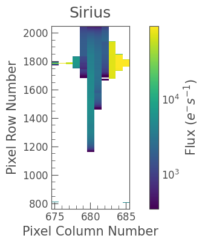
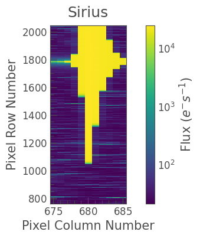
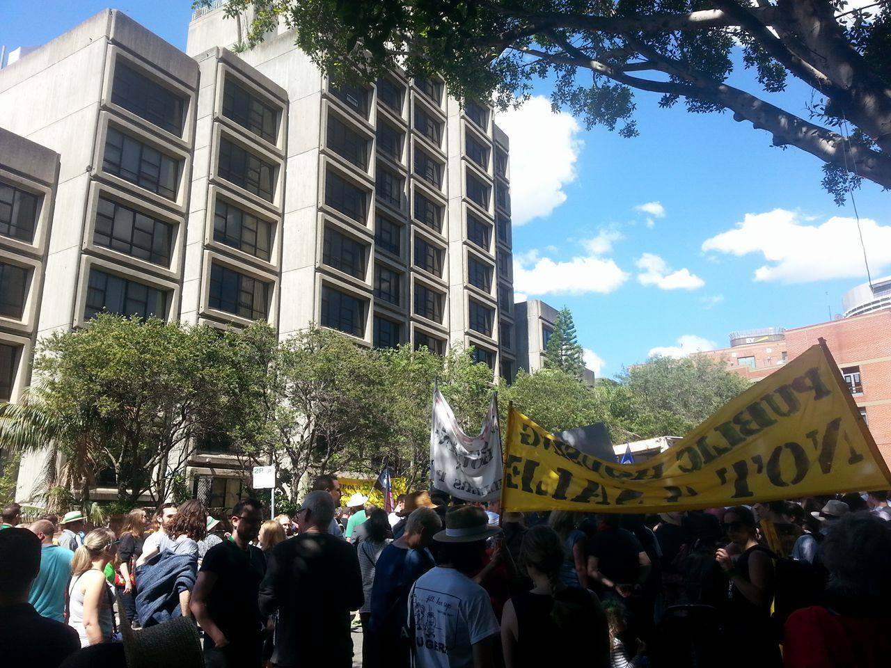

# mundey
[](http://www.gnu.org/licenses/gpl-3.0.html)
[](https://github.com/hvidy/mundey/actions/workflows/tests.yml)
[](https://badge.fury.io/py/mundey)

Saving Sirius — Recalibration of TESS target pixel files for the brightest stars

## Contributors

Tim White, Benjamin Pope

## Installation

From PyPI:

```bash
pip install mundey
```

With anonymous MAST S3 streaming support (`fsspec` + `s3fs`) for HPC prefetching:

```bash
pip install "mundey[hpc]"
```

From source:

```bash
pip install -e ".[dev,hpc]"
```

## Smear calibration problems for bright stars observed by TESS

Bright stars saturate the TESS cameras, resulting in excess charge bleeding along CCD columns. For particularly bright stars, and those high in the science frame and/or the upper buffer rows, this excess charge can bleed into the upper serial register and result in an overestimated smear correction. This not only renders data for these stars unusable, but also for any star that appears in the same CCD column. The image below shows one frame from the Sector 6 target pixel file for Sirius. Note that the aspect ratio has been adjusted because the image is extremely long (1287 pixels x 11 pixels). The colour scale is logarithmic; pixels that appear white are where the flux is negative as a result of the overestimated smear correction.



## Functional `lightkurve` v2 API (`mundey` v2.0)

`mundey` v2.0 provides pure functional transformations on standard `lightkurve.TargetPixelFile` objects executed in locally scoped 64-bit JAX precision (`@in_float64`, without mutating global `jax_enable_x64` state) and standardized under the **`HALOCVER = 1`** FITS contract:

```python
import lightkurve as lk
import mundey

tpf = lk.read("tess2018349182459-s0006-0000000322899250-0126-s_tp.fits")
cal_tpf = mundey.recalibrate_tpf(
    tpf,
    ddir="./notebooks",       # or fetched automatically from anonymous MAST S3 into cache_dir
    smear="automatic",        # 'alternate' when stamp reaches row 2048, else 'standard'
    cadence_match="cadenceno",
    offline=True,
)
cal_tpf.to_fits("sirius_s06_recalibrated_tp.fits", overwrite=True)
```

For `TessCut` or HLSP full-frame-image cutouts where raw `RAW_CNTS` and collateral `_col.fits` files are unavailable, use `mundey.desmear_calibrated_cutout`:

```python
cutout = lk.search_tesscut("Sirius", sector=6).download(cutout_size=(60, 25))
clean_cutout = mundey.desmear_calibrated_cutout(cutout)
```

### Key v2.0 physics & `HALOCVER = 1` guarantees

- **Physical calibration order**: Masks `RAW_CNTS == -1` sentinels to `NaN` in `float64`, subtracts frame-scaled 2D black ($N_{\text{eff}} \cdot B_{2\text{D}}$) independently for 2-minute (`CRMITEN=True`) and 20-second (`CRMITEN=False`) cadences across all 4 CCD outputs (`A`–`D`), fits cancellation-free orthonormal Legendre 1D black on clean overclock columns (`cols 3..9`), inverts causal LDE serial undershoot via `jax.lax.associative_scan` in ADU *before* clamping `linearity.xml` arguments to `[0, maxDomain]`, and preserves adjacent halo columns downstream of saturated bleed trails.
- **Exact `CADENCENO` collateral pairing**: Aligns TPF cadences to `smrow`, `tvcol`, and `-blf.fits` caches by exact integer `CADENCENO` equality (`cadence_match="cadenceno"`, with `missing_cadence="nan"` or `"error"`, or `cadence_match="positional"` for legacy reproduction) and records `CADMATCH` and `CADMISS` in `hdu[0].header`.
- **Concavity-guarded `smear="alternate"`**: Bridges clean non-strap flank columns horizontally across bleeding columns and estimates column smear with inverse-wing-weighted MAD-scaled Huber IRLS so radial PSF-wing concavity ($\propto \Delta r^{-5}$) does not self-subtract stellar pulsations and sky background remains intact (`BKGSUB = False`, `FLUX_BKG = 0`).
- **Slicing-safe uncertainties & spatial quality flags**: Appends column-coherent `SMEAR_ERR` (`(N_raw, nx)`, `e-/s`) directly to `hdu[1]` (`PIXELS`) alongside total marginal `FLUX_ERR` and writes spatial `PIXEL_QUALITY` (`STRAP_COL`, `SAT_BLEED`, `SMEAR_UNRESOLVED`, `SOURCE_MASK`, `BKG_USED`).

The legacy `mundey_tpf` subclass remains available as a `@deprecated` compatibility shim wired onto the v2.0 engine:

```python
from mundey import mundey_tpf

tpf = mundey_tpf("tess2018349182459-s0006-0000000322899250-0126-s_tp.fits")
tpf.calibrate(ddir="./notebooks", offline=True)
```

The image below shows the Sirius target pixel file after correction with `mundey`.



## Command-line interface & Swinburne NT / OzSTAR HPC workflow

`mundey` installs a `mundey` CLI with two subcommands:

```bash
# Stage 1 (login/mover or --tmp=25G Slurm array): stream 4,096-row chunks from MAST S3
mundey prefetch --sector 6 --camera 2 --ccd 3 --outputs B --cadence 2min --strict-hpc

# Stage 2 (offline compute nodes): recalibrate with zero network access
mundey calibrate tess...-s_tp.fits -o recalibrated_tp.fits --offline --strict-hpc --overwrite
```

A ready-to-submit Slurm array template for Swinburne Ngarrgu Tindebeek (`milan` CPU nodes, `$JOBFS` local NVMe staging, `$SCRATCH/.cache/tess_bright` lockless atomic `-blf.fits` publishing, pinned XLA/BLAS threads, and `EXIT`-trapped `.tar` archival to `/fred`) is provided at `hpc/mundey_prefetch.sbatch`.

## License

We invite anyone interested to use and modify this code under a GPL v3 license.

## Jack Mundey

Jack Mundey (1929-2020) was an Australian trade unionist and environmental activist. Rising to prominence as a leader of the New South Wales Builders' Labourers Federation (BLF) during the late 1960s and early 1970s, Mundey saw his role as not only advocating for improvement to the pay and working conditions of his comrades, but to ensure that their labour was used for the good of their society. To this end, and with the support of community groups, the BLF instituted a series of **green bans** on developments that would destroy the natural and built environment of Sydney. This is the original use of the word "green" in reference to environmental politics, a label that was taken up by Petra Kelly, co-founder of the German Green Party, following her visit to Sydney in 1977. Among the areas saved by green bans is The Rocks district of Sydney, which contains numerous historic buildings and was home to a vibrant working-class community.

The Sirius Building is an apartment complex in The Rocks that was built as public housing for local community members as a result of the green bans, and was completed in 1980. In 2015, the NSW state government made a decision to sell the building, driving out the working class and elderly residents, and placing the building at risk of demolition by the new owners. This decision prompted community protest and a new green ban was placed on the site by the CFMEU. While this action has saved the Sirius building from destruction, the sale eventually proceeded and the Sirius will no longer be public housing. It is apparently intolerable to the government that poor people may live in areas of high real estate value.


Save Our Sirius protest march outside the Sirius Building, 17 September 2016. Photo: Tim White

While trying to save observations of the star Sirius from an overestimated smear correction obviously pales in importance to trying to save the community of residents in the Sirius Building, we have chosen to name this code `mundey` in memory of Jack Mundey and the NSW BLF.
